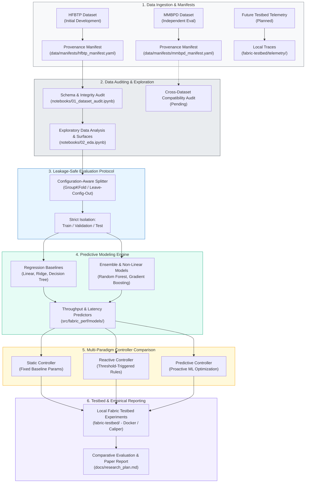

# AI-Assisted Adaptive Performance in Permissioned Blockchain Networks

> **An undergraduate research investigation into machine learning-based performance prediction and adaptive control for Hyperledger Fabric networks.**

[](https://github.com/AryanPrasad-5/AI-Assisted-Permissioned-Blockchain-Architecture-)
[](LICENSE)
[](pyproject.toml)
[](docs/dataset_catalog.md)
[](tests/)

---

## Authors & Project Metadata

- **Authors**: Aryan Prasad & Anuj Patel
- **Year**: 2026
- **Project Type**: Undergraduate Research Project
- **Repository**: [AryanPrasad-5/AI-Assisted-Permissioned-Blockchain-Architecture-](https://github.com/AryanPrasad-5/AI-Assisted-Permissioned-Blockchain-Architecture-)
- **Current Milestone**: Milestone 0 Completed &bull; Next: `feature/dataset-audit` (HFBTP Audit)

---

## Table of Contents

- [Overview](#overview)
- [Research Problem & Motivation](#research-problem--motivation)
- [Research Architecture & Pipeline](#research-architecture--pipeline)
- [Multi-Dataset Strategy](#multi-dataset-strategy)
- [Comparison of Control Paradigms](#comparison-of-control-paradigms)
- [Repository Structure](#repository-structure)
- [Interactive Research Roadmap](#interactive-research-roadmap)
- [Methodology & Evaluation Safeguards](#methodology--evaluation-safeguards)
- [Installation & Reproducibility](#installation--reproducibility)
- [Git Workflow (No Dev Branch)](#git-workflow-no-dev-branch)
- [Current Project Status](#current-project-status)
- [How to Cite This Work](#how-to-cite-this-work)
- [References & Acknowledgments](#references--acknowledgments)

---

## Overview

Permissioned blockchain architectures, such as **Hyperledger Fabric**, offer high throughput, data privacy, and deterministic transaction settlement for consortium use cases (e.g., cross-border interbank clearing). However, system performance is acutely sensitive to runtime transaction arrival patterns and underlying ledger configurations (such as block batch size, timeout intervals, and endorsement constraints).

This research investigates whether **machine learning models** trained on empirical workload benchmarks can:
1. **Accurately predict** transaction throughput (TPS) and average commit latency.
2. **Drive adaptive control decisions** to proactively tune network configurations, mitigating latency degradation under dynamic workloads without destabilizing consensus.

> [!NOTE]
> **Research Disclaimer**: This repository documents an ongoing undergraduate scientific investigation. Models, performance predictions, and adaptive mechanisms are subject to empirical evaluation against real benchmark files. This repository does not claim validated performance gains until rigorous, cross-validated experiments are completed and published.

---

## Research Problem & Motivation

```
Workload Fluctuations (Arrival Rate, Payload)
                      │
                      ▼
┌──────────────────────────────────────────────┐
│  Hyperledger Fabric Transaction Lifecycle    │
│  (Endorsement ➔ Ordering ➔ Validation/Commit)│
└──────────────────────────────────────────────┘
                      │
         Sensitivity to Configuration:
         • Batch Size (MaxMessageCount)
         • Batch Timeout (BatchTimeout)
                      │
       ┌──────────────┴──────────────┐
       ▼                             ▼
Static Configuration Failure    Dynamic Operating Window
• Too small: Orderer bottleneck • Low latency & high throughput
• Too large: High queue latency   require workload adaptation
```

### 1. Why Fixed (Static) Configurations Fail
In Hyperledger Fabric, the ordering service packages endorsed transactions into blocks governed by channel parameters:
- `MaxMessageCount` (Batch Size): Maximum transactions allowed per block.
- `BatchTimeout`: Maximum duration to wait before sealing a block if the batch size is not yet reached.

Under **low transaction arrival rates**, a large batch size causes transactions to wait for `BatchTimeout`, inflating commit latency. Under **congested burst traffic**, small batch sizes overload the ordering service with block creation overhead, exhausting network buffers and causing severe queuing delays. A static configuration cannot remain optimal across varying workload regimes.

### 2. Reactive vs. Predictive Adaptation
- **Reactive Control**: Monitors observed performance degradation (e.g., high queue depth or latency spikes) and triggers configuration adjustments post-facto. While simple, reactive control suffers from delayed response times, transient performance collapse, and configuration flapping during settling intervals.
- **Predictive Control**: Employs ML models to forecast upcoming throughput, latency, or overload risks based on arrival trends and operational state, proactively adjusting parameters before performance degrades.

### 3. Core Research Question
> *Can an ML-assisted predictive controller anticipate transaction congestion in Hyperledger Fabric and proactively optimize configuration parameters more effectively than fixed baseline configurations or threshold-based reactive controllers?*

---

## Research Architecture & Pipeline

The pipeline spans data ingestion, rigorous schema auditing, leak-free evaluation, regression modeling, and multi-paradigm controller comparison:



*Note: Shaded layers represent the progressive milestones of this project. Only Milestone 0 (foundation & contracts) is currently completed.*

---

## Multi-Dataset Strategy

To prevent overfitting to a single experimental setup, the repository explicitly decouples dataset ingestion and enforces independent evaluation:

| Dataset | Intended Role | Status | Description |
|---|---|---|---|
| **HFBTP** | Initial Audit & Development | **Initial Dataset** | Static benchmark grid used for schema auditing, exploratory analysis, and initial baseline model formulation. |
| **MMBPD** | Independent Evaluation | **Pending Compatibility Audit** | Held-out benchmark dataset reserved exclusively for testing cross-dataset generalization and transferability. |
| **Future Datasets** | Local Testbed Validation | **Planned** | Custom time-series benchmark traces collected directly from local Hyperledger Fabric experiments. |

<details>
<summary><strong>Data Governance, Provenance & Registration Protocols (Click to Expand)</strong></summary>

### 1. Immutability of Raw Data
All files deposited in [`data/raw/`](data/raw/) are strictly read-only and never modified. Transformations, feature derivations, and splits are written strictly to [`data/interim/`](data/interim/) or [`data/processed/`](data/processed/).

### 2. Provenance Manifest Schema
Every registered dataset must possess a valid YAML manifest adhering to [`data/manifests/manifest_schema.json`](data/manifests/manifest_schema.json). Required metadata fields include:
- `dataset_id`: Unique key (`hfbtp`, `mmbpd`).
- `source_url` & `citation`: Literature reference.
- `raw_files`: List of files accompanied by cryptographic SHA256 checksums.
- `target_variables`: Documented physical units (`tps`, `ms`, `s`).
- `experimental_setup`: Benchmark tool, blockchain version, consensus type, and replication counts.

### 3. No Blind Dataset Pooling
Datasets originating from different testbeds cannot be merged blindly. Varying hardware topologies, consensus configurations, transaction payload sizes, and measurement harnesses alter performance scales. Datasets are treated as distinct domains for zero-shot or few-shot cross-evaluation.

### 4. Common Loader Interface
All dataset loaders inherit from [`BaseDatasetLoader`](src/fabric_perf/data/base.py), guaranteeing a standardized contract:
```python
from fabric_perf.data import BaseDatasetLoader

class CustomDatasetLoader(BaseDatasetLoader):
    def load_raw(self) -> pd.DataFrame: ...
    def validate_schema(self, df: pd.DataFrame) -> dict: ...
    def get_feature_names(self) -> list[str]: ...
    def get_target_names(self) -> list[str]: ...
```

For complete dataset registration instructions, refer to [`data/README.md`](data/README.md) and [`docs/dataset_catalog.md`](docs/dataset_catalog.md).
</details>

---

## Comparison of Control Paradigms

This research evaluates three distinct operational philosophies for Hyperledger Fabric parameter management:

| Attribute | 1. Static Approach | 2. Reactive Approach | 3. Predictive Approach |
|---|---|---|---|
| **Control Mechanism** | Fixed channel parameters selected prior to execution. | Rule-based heuristics triggered after observed metric threshold breach. | Proactive ML regression models forecasting near-future throughput & latency. |
| **Operational Advantages** | Zero runtime computational or monitoring overhead; zero risk of controller oscillation. | Responds to sustained operational shifts without requiring offline model training. | Preempts saturation collapse; adjusts batch configuration before queue buildup occurs. |
| **Inherent Limitations** | Highly sub-optimal outside the calibrated workload regime. | Lagged response; cannot prevent initial latency spikes; prone to parameter hunting. | Inference computational overhead; risks sub-optimal tuning if model suffers distribution shift. |
| **Evaluation Requirements** | Matched baseline runs across low, medium, and congested workload curves. | Tuning threshold values ($\tau_{queue}$, $\tau_{latency}$) and cooldown intervals. | Regression accuracy (MAE, RMSE, $R^2$) + operational evaluation in simulated/live testbed. |
| **Current Status** | Interface stubbed ([`StaticController`](src/fabric_perf/controllers/base.py)) | Interface stubbed ([`ReactiveController`](src/fabric_perf/controllers/base.py)) | Interface stubbed ([`PredictiveController`](src/fabric_perf/controllers/base.py)) |

> [!IMPORTANT]
> **Prediction Accuracy &ne; Control Effectiveness**:
> High ML accuracy (e.g., $R^2 > 0.95$) is a prerequisite, but it does **not** prove an operational controller will improve a live blockchain network. Dynamic factors—including channel reconfiguration transaction delays, endorsement latencies, and actuation overhead—must be evaluated experimentally on a running network.

---

## Repository Structure

The repository maintains strict separation between immutable data, declarative configurations, reusable Python package logic, and ephemeral experiment outputs:

```text
AI-Assisted-Permissioned-Blockchain-Architecture-/
├── .gitignore                      # Excludes raw datasets, virtual envs, caches, model weights
├── README.md                       # Project overview and research documentation
├── pyproject.toml                  # PEP 517/621 packaging specifications & test configuration
├── requirements.txt                # Pinned dependencies
├── LICENSE                         # MIT License
│
├── data/                           # Multi-dataset storage (local data excluded from git)
│   ├── README.md                   # Data registration manual and provenance instructions
│   ├── manifests/                  # Dataset metadata specifications & JSON schema
│   │   ├── manifest_schema.json    # JSON schema for dataset provenance validation
│   │   ├── hfbtp_manifest.yaml     # Registration manifest for HFBTP
│   │   └── mmbpd_manifest.yaml     # Registration manifest for MMBPD
│   ├── raw/                        # Immutable raw benchmark downloads (git-ignored)
│   │   ├── hfbtp/                  # HFBTP raw benchmarks (.gitkeep)
│   │   ├── mmbpd/                  # MMBPD raw benchmarks (.gitkeep)
│   │   └── external/               # Reference datasets (.gitkeep)
│   ├── interim/                    # Cleaned intermediate artifacts (.gitkeep)
│   └── processed/                  # Feature matrices ready for model consumption (.gitkeep)
│
├── configs/                        # Declarative YAML configurations
│   ├── datasets/                   # Dataset loader & feature splitting specs (hfbtp.yaml, mmbpd.yaml)
│   ├── experiments/                # End-to-end pipeline execution configs (baseline_template.yaml)
│   └── models/                     # Model architecture and hyperparameter configs (regression_template.yaml)
│
├── notebooks/                      # Sequential research exploration notebooks
│   └── README.md                   # Progression guide: 01_audit to 05_comparison
│
├── src/                            # Reusable core library: fabric_perf
│   └── fabric_perf/
│       ├── __init__.py             # Package version (__version__ = "0.1.0")
│       ├── data/                   # Dataset loaders implementing BaseDatasetLoader
│       │   ├── base.py             # Abstract base loader interface
│       │   ├── hfbtp.py            # HFBTP loader & schema auditor
│       │   └── mmbpd.py            # MMBPD loader & schema auditor
│       ├── features/               # Feature engineering & scaling pipelines
│       ├── models/                 # Model abstractions & wrappers (BasePerformanceModel)
│       ├── evaluation/             # Leakage prevention & metrics
│       │   ├── metrics.py          # MAE, RMSE, R2, safe MAPE implementations
│       │   └── splitters.py        # Configuration-aware GroupShuffleSplit logic
│       ├── controllers/            # Control paradigm implementations
│       │   └── base.py             # Static, Reactive, and Predictive controller classes
│       └── utils/                  # Reproducibility seeds and structured logging
│           ├── logging.py          # Standardized research console logger
│           └── seeds.py            # Global seed_everything utility
│
├── tests/                          # Automated unit and contract test suite
│   ├── __init__.py                 # Test configuration ensuring src/ resolution
│   ├── test_imports.py             # Package import and metadata test
│   └── test_data_contract.py       # Data contract, controller, and metrics tests
│
├── experiments/                    # Local experiment outputs (git-ignored)
│   ├── README.md                   # Directory documentation
│   ├── results/                    # Tabular metrics and JSON run summaries (.gitkeep)
│   ├── figures/                    # Publication-grade PNG/PDF plots (.gitkeep)
│   └── logs/                       # Execution run logs (.gitkeep)
│
├── fabric-testbed/                 # Local Hyperledger Fabric network environment (Milestone 8)
│   ├── README.md                   # Testbed execution manual
│   ├── configs/                    # Docker Compose & crypto material (.gitkeep)
│   ├── workloads/                  # Caliper benchmark workloads (.gitkeep)
│   └── telemetry/                  # Prometheus metrics traces (.gitkeep)
│
└── docs/                           # Formal research documentation
    ├── research_plan.md            # Phased research plan and milestone definitions
    ├── dataset_catalog.md          # Multi-dataset provenance catalog
    ├── methodology.md              # Mathematical formulation of the 3 control paradigms
    └── evaluation_protocol.md      # Leakage-safe evaluation & splitting protocols
```

---

## Interactive Research Roadmap

Progress is tracked via sequential research milestones. Each milestone is executed on an isolated feature branch and merged directly into `main` upon verification:

- [x] **Milestone 0: Repository Architecture & Contracts**
  - Scaffold clean multi-dataset directory structure.
  - Implement `BaseDatasetLoader`, `BasePerformanceModel`, and `BaseController` interfaces.
  - Configure `.gitignore`, `pyproject.toml`, and strict reproducibility utilities.
  - Implement unit and contract test suite (verified 6/6 tests passing).
- [ ] **Milestone 1: HFBTP Dataset Audit & Registration** (`feature/dataset-audit`)
  - Acquire raw HFBTP benchmark files into `data/raw/hfbtp/`.
  - Validate column types, missingness, duplicate parameter cells, and checksums.
  - Verify whether HFBTP is a static parameter grid (replications, timestamps).
  - Execute [`notebooks/01_dataset_audit.ipynb`](notebooks/).
- [ ] **Milestone 2: Exploratory Data Analysis & Surfaces** (`feature/eda`)
  - Map throughput and latency response surfaces across transaction arrival rates.
  - Characterize non-linear saturation knee-points and queuing cliffs.
  - Execute [`notebooks/02_eda.ipynb`](notebooks/).
- [ ] **Milestone 3: Leakage-Safe Evaluation Protocol** (`feature/evaluation-protocol`)
  - Implement configuration-aware and group-aware cross-validation splitters.
  - Formalize train/validation/test isolation rules and target leakage guards.
- [ ] **Milestone 4: Regression Baselines** (`feature/baseline-models`)
  - Train Linear, Ridge, and Decision Tree baseline models.
  - Benchmark MAE, RMSE, and $R^2$ performance on unseen configuration splits.
  - Execute [`notebooks/04_baseline_models.ipynb`](notebooks/).
- [ ] **Milestone 5: Advanced Model Training & Tuning** (`feature/model-training`)
  - Train Random Forests, Gradient Boosted Trees (XGBoost/LightGBM).
  - Hyperparameter optimization and residual error diagnosis.
- [ ] **Milestone 6: Cross-Dataset Generalization on MMBPD** (`feature/cross-dataset-validation`)
  - Audit MMBPD schema compatibility against HFBTP features and target units.
  - Evaluate out-of-domain generalization and transferability.
- [ ] **Milestone 7: Static, Reactive & Predictive Controllers** (`feature/controllers`)
  - Implement reactive threshold rules and proactive ML-driven controller logic.
  - Benchmark control decision latency and oscillation stability.
- [ ] **Milestone 8: Controlled Local Fabric Testbed Experiments** (`feature/fabric-testbed`)
  - Deploy local Hyperledger Fabric network with Caliper workload generation.
  - Measure live adaptive response under bursty and fluctuating workloads.
- [ ] **Milestone 9: Research Report & Final Analysis** (`feature/research-report`)
  - Synthesize statistical comparisons, error analysis, and publication-ready figures.

---

## Methodology & Evaluation Safeguards

### 1. Regression Metrics
Performance prediction models are evaluated independently on both target variables ($T$: Throughput, $L$: Latency):
- **Mean Absolute Error (MAE)**: Measures average prediction error in physical units (TPS or milliseconds).
- **Root Mean Squared Error (RMSE)**: Penalizes large outlier errors, critical for anticipating latency spikes.
- **Coefficient of Determination ($R^2$)**: Quantifies proportion of variance explained by the model relative to the mean.
- **Mean Absolute Percentage Error (MAPE)**: Normalized metric to facilitate cross-scale comparison.

### 2. Leakage-Safe Data Splitting
Standard random splits (`train_test_split(shuffle=True)`) create severe **data leakage** in benchmark datasets because identical or neighboring configuration cells appear in both training and test sets. 

To prevent synthetic score inflation:
- **Configuration-Aware Splitting**: Observations are grouped by parameter settings (`batch_size`, `batch_timeout`) using [`GroupShuffleSplit`](src/fabric_perf/evaluation/splitters.py). Entire configuration cells are reserved exclusively for either training or testing.
- **Target Leakage Prohibition**: Contemporaneous measured throughput is strictly prohibited as a feature when predicting latency, as it is an unmeasured outcome at prediction time.

### 3. Controller Operational Evaluation
When comparing controllers ([`StaticController`](src/fabric_perf/controllers/base.py), [`ReactiveController`](src/fabric_perf/controllers/base.py), [`PredictiveController`](src/fabric_perf/controllers/base.py)), ML accuracy is complemented by operational system metrics:
- **Delivered Throughput**: Total committed transactions per unit time.
- **Average & Tail Latency**: P50, P95, and P99 transaction latencies.
- **SLA Violation Rate**: Percentage of time latency exceeds a defined operational threshold.
- **Oscillation Index**: Frequency of channel configuration updates (penalizing controller flapping).

For details, refer to [`docs/methodology.md`](docs/methodology.md) and [`docs/evaluation_protocol.md`](docs/evaluation_protocol.md).

---

## Installation & Reproducibility

### Prerequisites
- **Python**: Version 3.10 or higher (Tested on Python 3.14)
- **Git**: Installed and configured
- **OS**: Windows (PowerShell), Linux, or macOS

### 1. Clone the Repository
```powershell
git clone https://github.com/AryanPrasad-5/AI-Assisted-Permissioned-Blockchain-Architecture-.git
cd AI-Assisted-Permissioned-Blockchain-Architecture-
```

### 2. Environment Setup (Windows PowerShell)
```powershell
# Create virtual environment
python -m venv .venv

# Activate virtual environment
.\.venv\Scripts\Activate.ps1

# Install package in editable mode with development dependencies
pip install -e .[dev]
```

<details>
<summary><strong>Linux / macOS Bash Setup Instructions (Click to Expand)</strong></summary>

```bash
# Create virtual environment
python3 -m venv .venv

# Activate virtual environment
source .venv/bin/activate

# Install package in editable mode
pip install -e .[dev]
```
</details>

### 3. Execute Automated Test Suite
Verify that all data contracts, package imports, controllers, and evaluation metrics pass:
```powershell
python -m unittest discover -s tests -v
```
*(Or run `pytest` if installed in your environment)*

**Expected Result:**
```text
test_loader_inheritance (test_data_contract.TestDataContract.test_loader_inheritance) ... ok
test_loader_schema_audit (test_data_contract.TestDataContract.test_loader_schema_audit) ... ok
test_metrics_calculation (test_data_contract.TestDataContract.test_metrics_calculation) ... ok
test_seed_reproducibility (test_data_contract.TestDataContract.test_seed_reproducibility) ... ok
test_static_controller (test_data_contract.TestDataContract.test_static_controller) ... ok
test_package_metadata (test_imports.TestImports.test_package_metadata) ... ok

Ran 6 tests in 0.044s
OK
```

---

## Git Workflow (No Dev Branch)

To preserve a linear, reproducible research history, **no long-lived `dev` branch is used**. 

```text
main ────────●───────────────────────────────────────────────● (Milestone Merged)
              \                                             /
               └── feature/dataset-audit ──●───────●───────┘
                                        (commit) (commit)
```

1. **`main`**: Contains verified, reproducible milestones and passing test suites.
2. **Short-Lived Feature Branches**: Dedicated to single, clearly scoped milestones.

### Example Workflow:
```powershell
# 1. Switch to main and pull latest changes
git checkout main
git pull origin main

# 2. Create feature branch for the specific milestone
git checkout -b feature/dataset-audit

# 3. Implement code, audit data, and run tests
python -m unittest discover -s tests -v

# 4. Stage and commit changes with descriptive messages
git add data/manifests/hfbtp_manifest.yaml src/fabric_perf/data/hfbtp.py
git commit -m "feat(data): audit HFBTP dataset schema and verify parameter grid"

# 5. Merge directly into main upon verification
git checkout main
git merge feature/dataset-audit

# 6. Delete the completed local feature branch
git branch -d feature/dataset-audit

# 7. Push updated main to GitHub
git push origin main
```

---

## Current Project Status

- **Status**: Research in Progress
- **Completed Components**:
  - Research repository scaffold, data layers, and manifest validation schemas.
  - Extensible Python package architecture ([`src/fabric_perf/`](src/fabric_perf/)).
  - Unit and contract test suite passing 6/6 tests.
  - Reproducibility documentation, research plan, and evaluation protocols.
- **Planned / Pending Components**:
  - Model training, hyperparameter tuning, and controller benchmarking.
  - Caliper workload execution on local Hyperledger Fabric network.
- **Immediate Next Task**:
  - Milestone 1: Create `feature/dataset-audit`, register raw HFBTP benchmark files, and execute initial schema validation.

---

## How to Cite This Work

If you reference this research repository or build upon this architecture in your studies, please cite it using the following BibTeX entry:

```bibtex
@misc{ai-adaptive-permissioned-blockchain,
  title  = {AI-Assisted Adaptive Performance in Permissioned Blockchain Networks},
  author = {Aryan Prasad and Anuj Patel},
  year   = {2026},
  note   = {Undergraduate research project},
  url    = {https://github.com/AryanPrasad-5/AI-Assisted-Permissioned-Blockchain-Architecture-}
}
```

*Note: This repository represents ongoing undergraduate research hosted on GitHub and does not claim formal peer-reviewed publication status.*

---

## References & Acknowledgments

- **Hyperledger Fabric**: An enterprise-grade permissioned distributed ledger framework ([Documentation](https://hyperledger-fabric.readthedocs.io/)).
- **Hyperledger Caliper**: A blockchain benchmark framework enabling execution of pre-defined workloads ([Documentation](https://hyperledger.github.io/caliper/)).
- **Scikit-Learn**: Machine learning library in Python ([Documentation](https://scikit-learn.org/)).

---

<p align="center">
  <sub>Maintained by <a href="https://github.com/AryanPrasad-5">Aryan Prasad</a> and Anuj Patel &bull; Licensed under the <a href="LICENSE">MIT License</a></sub>
</p>
