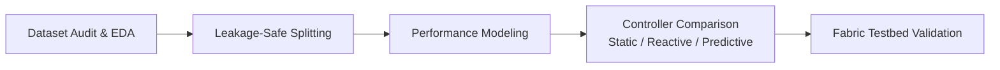

# Performance-Aware Configuration and Adaptive Control in Hyperledger Fabric

## Overview
Permissioned blockchain networks like Hyperledger Fabric exhibit performance characteristics—primarily transaction throughput and commit latency—that are sensitive to workload intensity and channel configuration settings (such as block batch size and timeout intervals). Operating with fixed configurations can result in poor trade-offs, where low arrival rates suffer from timeout-induced latency and high arrival rates saturate ordering and validation pipelines. This research investigates whether performance-aware prediction models and adaptive control mechanisms can dynamically select configurations to improve Fabric performance across varying workload conditions.

## Research Objectives
- **Characterize Performance Trade-Offs**: Analyze how workload arrival rates and configuration parameters (`BatchSize`, `BatchTimeout`) interact to affect throughput and latency.
- **Performance Prediction**: Evaluate how accurately regression and machine learning models can estimate transaction throughput and commit latency using information available prior to block assembly.
- **Compare Control Paradigms**: Systematically compare three configuration strategies under equivalent workloads:
  - *Static Approach*: Fixed, preselected configurations held constant during execution.
  - *Reactive Approach*: Parameter adjustments triggered after observed metrics cross defined degradation thresholds.
  - *Predictive Approach*: Proactive adjustments guided by model estimates of near-future performance and saturation risk.
- **Cross-Dataset Generalization**: Assess whether learned performance relationships generalize across independent benchmark datasets and network environments.

## Methodology
The investigation follows an empirical experimental progression:
1. **Dataset Audit and Provenance**: Verify file integrity, measurement units, schema definitions, and the nature of benchmark observations (e.g., parameter grid points versus temporal traces).
2. **Exploratory Data Analysis**: Characterize throughput saturation limits, latency cliffs, and non-linear parameter interactions.
3. **Leakage-Safe Model Evaluation**: Implement configuration-aware and group-aware data splits (such as `GroupShuffleSplit`) to prevent identical parameter combinations from appearing in both training and test partitions.
4. **Baseline and ML Modeling**: Train baseline regression models (Linear, Ridge, Decision Tree) alongside ensemble learners (Random Forest, Gradient Boosting) using standard metrics (MAE, RMSE, $R^2$).
5. **Controller Formulation**: Model static, reactive, and predictive controller interfaces to compare decision logic and parameter stability.
6. **Testbed Validation (Planned)**: Validate findings on a controlled local Hyperledger Fabric network running Caliper benchmarks to evaluate operational throughput, latency distributions, and reconfiguration stability.



## Datasets
The repository supports multiple independent datasets to prevent single-benchmark overfitting:

| Dataset | Role | Status | Description |
|---|---|---|---|
| **HFBTP** | Initial Development | Initial Dataset (Pending Audit) | Literature benchmark parameter grid used for initial schema auditing and response-surface modeling. |
| **MMBPD** | Independent Evaluation | Candidate (Pending Audit) | Multi-scenario benchmark dataset reserved for evaluating cross-dataset generalization. |
| **Future Datasets** | Experimental Validation | Planned | Additional public benchmarks or local Hyperledger Fabric telemetry traces. |

Raw datasets remain immutable and excluded from version control. Loaders inherit from a common base class ([`BaseDatasetLoader`](src/fabric_perf/data/base.py)) to ensure consistent schema validation and feature/target contracts across sources.

## Repository Structure
```text
AI-Assisted-Permissioned-Blockchain-Architecture-/
├── data/               # Raw, interim, and processed datasets with provenance manifests
├── configs/            # YAML configurations for datasets, models, and experiments
├── notebooks/          # Exploratory analysis and audit notebooks
├── src/fabric_perf/    # Core package: data loaders, evaluation, controllers, utilities
├── tests/              # Unit and contract test suite
├── experiments/        # Outputs: results, figures, and execution logs
├── fabric-testbed/     # Local Hyperledger Fabric network configs and workloads
└── docs/               # Research plan, dataset catalog, methodology, and evaluation protocols
```

## Getting Started

### Prerequisites
- Python 3.10+
- Git

### Installation
```powershell
# Clone the repository
git clone https://github.com/AryanPrasad-5/AI-Assisted-Permissioned-Blockchain-Architecture-.git
cd AI-Assisted-Permissioned-Blockchain-Architecture-

# Create and activate virtual environment
python -m venv .venv
.\.venv\Scripts\Activate.ps1

# Install package in editable mode
pip install -e .[dev]
```

### Running Tests
Execute the contract and unit test suite:
```powershell
python -m unittest discover -s tests -v
```

## References

1. **Androulaki, E., et al.** (2018). *Hyperledger Fabric: A Distributed Operating System for Permissioned Blockchains*. Proceedings of the Thirteenth EuroSys Conference (EuroSys '18), Article 30, 1–15. [https://doi.org/10.1145/3190508.3190538](https://doi.org/10.1145/3190508.3190538).
2. **Nasir, Q., et al.** (2018). *Performance Analysis of Hyperledger Fabric Platforms*. Security and Communication Networks, 2018, 1–14. [https://doi.org/10.1155/2018/3976093](https://doi.org/10.1155/2018/3976093).
3. **Hyperledger Foundation**. *Hyperledger Fabric Documentation*. [https://hyperledger-fabric.readthedocs.io/](https://hyperledger-fabric.readthedocs.io/).
4. **Hyperledger Foundation**. *Hyperledger Caliper Benchmark Tool*. [https://hyperledger.github.io/caliper/](https://hyperledger.github.io/caliper/).

### How to Cite
```bibtex
@misc{ai-adaptive-permissioned-blockchain,
  title  = {AI-Assisted Adaptive Performance in Permissioned Blockchain Networks},
  author = {Aryan Prasad and Anuj Patel},
  year   = {2026},
  note   = {Undergraduate research project},
  url    = {https://github.com/AryanPrasad-5/AI-Assisted-Permissioned-Blockchain-Architecture-}
}
```
